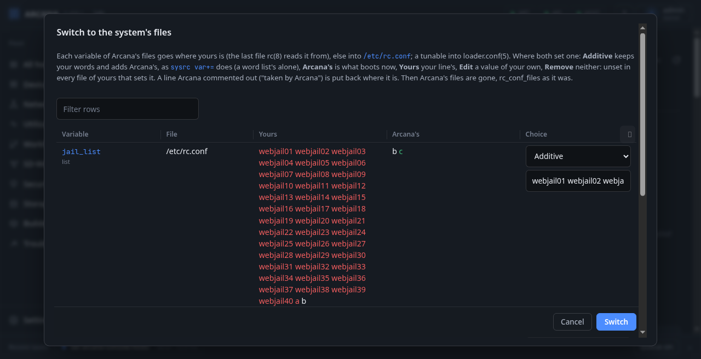

# Configuration files

What a commit keeps of a host's `rc.conf(5)` variables and
`loader.conf(5)` tunables goes to one of two places, Arcana's own files
or the system's. **System**, **General**, **Configuration files** says
which a host uses, with **Switch** beside it.

| | rc.conf variables | loader tunables | kept firewall rules |
|---|---|---|---|
| **Arcana's own files** (the default) | `/usr/local/etc/rc.conf.d/arcana`, named last in `rc_conf_files` | `/boot/loader.conf.d/arcana.conf` | `/usr/local/etc/arcana/ipfw.rules`, booted by the script beside it |
| **The system's** | the last of your files rc(8) reads that sets it, else `/etc/rc.conf` | the last loader file that sets it, else `/boot/loader.conf` | `/etc/ipfw.rules` and `/etc/ipfw.sh`, unless they are yours |

With Arcana's own files, rc(8) reads Arcana's file after yours, so what
it sets wins while your lines stay as they are, and taking Arcana away
is taking its files away. With the system's, what Arcana writes is in
your files, where you would have written it by hand, and Arcana keeps a
ledger of it.

The host keeps its choice in `/usr/local/etc/arcana/config-files.conf`,
read when the agent starts, and changes it by the switch alone, since
the switch moves files. State and actions are arcana-agent's
`agent/config-files` (`mode`, `rc-file`, `loader-file`,
`firewall-rules`, `pending`, `ledger`; the actions `switch` and
`resolve`, an admin's).

## A variable your files set too

Either way, a commit that changes a variable your own files set, to
something else, is a warning first: `rc-conf-conflict`
(`loader-conf-conflict` for a tunable), with a button that accepts it
and commits again. Nothing of yours is ever commented out. Accepted:

- **A word list** (`cloned_interfaces`, `jail_list`, `static_routes`,
  `kld_list` and the others of its kind) is merged additively: your
  words in their order, then the commit's that are not there, as
  `sysrc var+=` adds each. A word the commit takes out, one Arcana had
  or one the page read and left out, comes out of the list. With
  Arcana's own files the merge is written to Arcana's file, your line
  untouched; with the system's, where your line is.
- **A value** that no merge of words gives (a scalar, such as
  `hostname`) is not written. The commit is refused again with
  `rc-conf-merge`, and the page opens its **merge editor**: your value
  and Arcana's side by side, the words each has that the other has not
  marked, and a result to edit. The results go to the host (`resolve`),
  and the commit is sent again accepting `rc-conf-merge`. A tunable's
  value is the page's own, so a `loader-conf-conflict` is edited in the
  page and accepted, with no merge editor.

The **ledger**, `/var/db/arcana/config-ledger`, records what Arcana
changed of a variable your files set: the file, your value before,
the value Arcana wrote. A variable still as the ledger says Arcana left
it is not asked about again. **Release** (arcana-services' `release`)
gives back what Arcana added: with Arcana's own files its lines out,
yours never changed; with the system's, by the ledger, Arcana's words
out of a merged list, a value back to yours where it is still what
Arcana wrote, a variable Arcana added alone taken out.

## The switch

**Switch** opens a dry run first, which changes nothing.

From Arcana's files to the system's, it lists a row for each variable
and tunable of Arcana's files: your value, Arcana's, the file it would
end in, and a choice.

- **Additive** keeps your words and adds Arcana's, as `sysrc var+=`
  does; a word list's alone, and its default.
- **Arcana's** is what boots now.
- **Yours** is your line's.
- **Edit** writes a value of your own.
- **Remove** writes it nowhere, and unsets it in every file of yours
  that sets it.

A variable your files do not set takes Arcana's value by default, in
`/etc/rc.conf` (`/boot/loader.conf` for a tunable), or Edit or Remove.
One whose values differ has no default: the switch is refused
(`config-merge`) until each such row has a choice. A line an older
Arcana commented out is put back where it is, then written as chosen.
Then Arcana's files are removed and its path taken out of
`rc_conf_files`, the kept firewall rules move to `/etc/ipfw.rules` and
`/etc/ipfw.sh` (unless those are there and yours: then the firewall
stays in Arcana's directory, and the result says so), and every row is
written to the ledger.

From the system's files back to Arcana's, the switch is a clone: every
variable your `rc_conf_files` set, and every tunable of the loader's
files, is copied into Arcana's files, and Arcana's file is named in
`rc_conf_files`, the one line of yours that changes. rc(8) and the
loader read Arcana's files last, so what boots is the same. The ledger
is emptied: its merges are your lines now.

Before anything is written, every file the switch changes or removes
is copied into `/var/db/arcana/config-switch/<time>/`, its path and
mode kept, and named in the result; a failure puts every file back and
the mode as it was. Nothing is loaded live: rc(8) reads rc.conf when
each service starts and at boot, the loader at the next boot.

A jail's rc.conf and a jail's firewall are the jail's own, not the
host's choice.

## Where Arcana's own file cannot work

`/etc/rc` reads `rc_conf_files` once, as it starts, before the local
filesystems are mounted, and does not read them again. On a host whose
`/usr/local` is a filesystem of its own (a ZFS dataset of its own, as
some layouts make it), Arcana's file is missed at every boot: every
variable in it, the agent's own `arcana_agent_listen` too, which
leaves the agent on its local socket alone until it is restarted by
hand.

So on such a host Arcana's own files are refused: a commit that would
write Arcana's file is refused with `rc-conf-not-at-boot`, which no
acceptance passes, and so is a switch to Arcana's files. The System
tab says so beside **Switch**, and switching to the system's files is
the way. The agent says it in its log as it starts, and its rc script
too; `agent/config-files/arcana-at-boot` is false there.

**FreeBSD:** `rc.conf(5)`'s `rc_conf_files` and `/etc/rc.conf.d`,
read by `rc(8)` and each `rc.subr(8)` script; `loader.conf(5)` and
`/boot/loader.conf.d`, read by `loader(8)`; a word list merged as
`sysrc(8)`'s `+=` merges it; `ipfw(8)`'s rules loaded by
`firewall_script`.

