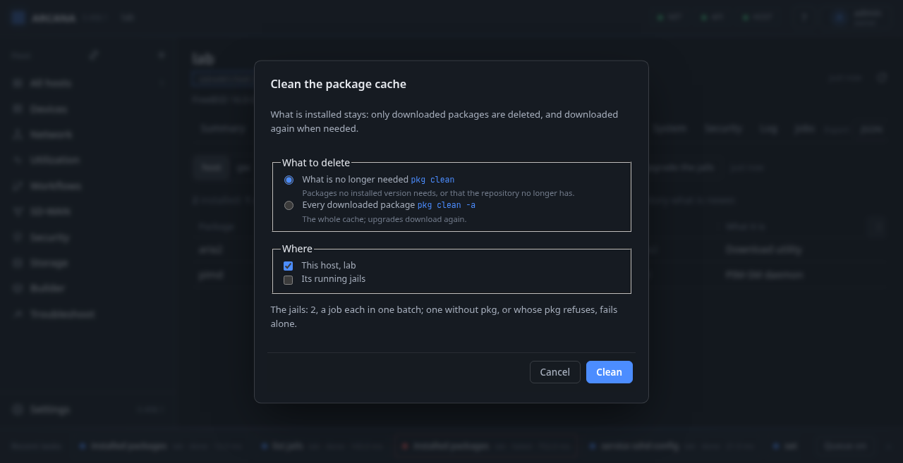

# Packages and jobs

## Packages

Of the host or a running jail. **Installed**, at first, lists what is
installed, from the host's own database without asking the repository:
each package's version, whether it was asked for by hand or came
automatically as what another needs, its size, its port and what it is.

- **Upgrades** asks the repository what is newer, with **Check** (`pkg
  update` first), a dry run, and **Upgrade** of the selected packages
  or of all.
- **Network** says how `pkg` reaches the repository: IPv4 or IPv6
  (either), IPv4 only (`pkg -4`) or IPv6 only (`pkg -6`); pressed, a box
  changes it. Every box that has `pkg` contact the repository (Install…,
  an upgrade, a base conversion) asks it again, the last choice
  already picked and kept in the browser for the next time.
- **From**, beside Upgrade and in Install…, takes the packages from one
  of the repositories `pkg` is configured with there alone (`pkg
  upgrade -r`, `pkg install -r`), enabled or not, such as a Builder's
  poudriere repository with a debug build of BIRD; **any repository**
  leaves it to `pkg`'s own configuration
  ([pkg.conf(5)](https://man.freebsd.org/pkg.conf/5)). The agent
  refuses a name that is not one of them.
- **Clean…** empties `pkg`'s cache of downloaded packages; what is
  installed stays. One box asks what: what is no longer needed,
  packages no installed version needs or that the repository no longer
  has (`pkg clean`), or every downloaded package (`pkg clean -a`), which
  upgrades then download again. On the host's page it asks where too:
  the host, its running jails, or both; the jails are a job each in one
  batch, so a jail without `pkg`, or whose `pkg` refuses, fails alone.
  On a jail's page it is that jail's.

  
- **Upgrade the jails**, on the host's page, upgrades every running
  jail's packages at once (`pkg upgrade -y` in each), a job each in one
  batch, after asking: a jail without `pkg`, or whose repositories
  cannot be read, fails alone. The host's own packages are not touched.
  Beside the button, the host's **lanes** and how many of its jobs run
  now ("4 lanes, 2 jobs running"): the agent runs that many of these
  jobs at once, each in a jail of its own, a jail's own one after
  another, so a download that stalls in one jail holds up no other;
  the next job of another kind waits for them. Four by default, 1 to
  32, set on the Jobs tab (`arcana-jobs` `lanes`, kept in
  `/usr/local/etc/arcana/jobs.conf`). The confirmation says both, and
  names the running jails that are on pkgbase: in those the same
  upgrade moves the FreeBSD base system packages (`FreeBSD-*`) too, to
  what their base repository has now, a new patch level or snapshot,
  and the jail may want a restart after it.
- **Install…** installs packages by name, on the host or in the jail
  picked (`pkg install -y`).

### Before pkg: the repository asked

Before `pkg update`, an upgrade, an install, or a jail's base by pkg,
the agent asks the repository whether it answers from where `pkg`
will run: attached to the jail (or on the host), it fetches the
repository's `meta.conf` from the URL `pkg -vv` gives, following an
SRV record as `pkg` does and using `PKG_ENV`'s proxies, IPv6 and IPv4
raced. If nothing answers within 8 seconds (`--repo-reach`), `pkg` is
not started, and the job fails saying what was tried and which address
families the jail or host has: a jail with no route out fails in
seconds, not after a stalled download. **Don't check the repository**
in a package box skips the question (a job's `no-repo-check`,
`arcanactl -R`).

### A pkg that falls silent

`pkg` is watched while it runs. While it fetches, ten minutes of
silence (`--pkg-idle`, 600 s) stop it, with what it started in the
jail, and the job fails saying so, and whether the repository answered
when asked after. Once it has begun installing, silence is most often
a package's script at work: the job's trace says that `pkg` waits on a
package's script, with the last line `pkg` printed, and `pkg` is
stopped only after three times `--pkg-idle` (30 minutes). A failed
fetch's error carries `pkg`'s own lines about it, the URL and the
reason. A running job's trace shows what its program has printed so
far, and one at work can be cancelled from **Recent tasks**.

After an upgrade, what is still pending is read from `pkg`'s catalogue
(`pkg version -U`), without asking the repository again. A `pkg` that
an agent left running when it restarted (an update) is stopped by the
agent that follows (SIGTERM, then SIGKILL after 5 seconds), found by
the `ARCANA_AGENT_JOB` in its environment, and listed as a job that
failed: "stopped: the agent restarted under it".
### A jail's base system by pkg

A running jail of FreeBSD 15.1 or later whose base system is still the
release's files has **To pkgbase…** on its packages: the base system
packages installed over its files, from the FreeBSD-base repository of
its own release (or a newer branch, `16` for the latest of that major),
the sets named (`FreeBSD-set-base-jail` when none;
`FreeBSD-set-minimal-jail` is smaller). A jail already on pkgbase has
**Base upgrade…** instead: to the release named, `16` or `15.2`, its
base packages first, then its other packages for the new ABI, never
beyond the host's kernel.

- **Base repository**: by default FreeBSD's official repository,
  written into the jail under Arcana's own name, **arcana-base**
  (`/usr/local/etc/pkg/repos/arcana-base.conf`), so that a mirror of
  yours named like FreeBSD's is not merged into it. Once the job is
  through the file is taken out again, since the base installed has
  its own `FreeBSD-base`; a job that failed keeps it. Or
  one of the jail's own repositories, as it is: it must have the
  release.
- Both keep the jail's `/etc` aside in `/var/backups` first, put back
  the jail's own files `pkg` set aside (its users and groups merged
  with the new base's accounts), and name in the trace the packages'
  versions left beside them as `.pkgnew`, to merge by hand. Restart
  the jail after.

`pkg` sets flags on the base system's files (`chflags(2)`, such as
`schg`), which a jail may do only with `allow.chflags`. Where the jail
may not, the agent refuses a conversion or a base upgrade before
anything changes (an upgrade or install of packages fails where `pkg`
meets the flag, and says why), and the page asks: **Allow now and retry** sets `allow.chflags` on the running
jail alone, not in its file, so it is gone at the jail's next start,
and not in safe mode, then sends the same job again. The question
comes for a conversion, a base upgrade, and an upgrade or install of
packages in a jail on pkgbase.

### Newer than the host

When `pkg` refuses packages built for a newer FreeBSD than the host's
(OSVERSION), the console asks whether to go on anyway, and approved,
does it again with `IGNORE_OSVERSION=yes`.

From a shell: `arcanactl packages [-i] [-r] [-4 | -6] [jail]` (with the
repositories), `pkg-upgrade [-O] [-R] [-r repo] …`, `pkg-clean [-a] [-j jail | -J]`, `pkg-install [-O] [-4 | -6] [-r repo]
[-j jail] package …`, `jail-base jail convert [-r repo] [-b release] [set …]`,
`jail-base jail upgrade [-r repo] release`.

## Jobs

The host's own record of what it was asked to change, by this console
or with `arcanactl -q`: the last 64, forgotten when the agent restarts.
A row opens its trace. Above the list it says what the agent is doing
now that is not a job, a request somebody waits for such as a check of
the packages, since when, and whether the agent was told to stop and
waits for it.

**FreeBSD:** `pkg(8)`, for a jail with `pkg -j`, its repositories
`pkg.conf(5)`, asked first by `fetch(3)` from inside the jail; pkgbase's `FreeBSD-set-*` packages; `jail(8)`'s
`allow.chflags` and `chflags(2)`. A job is the agent's own, run by a
thread of it and kept in its memory.

