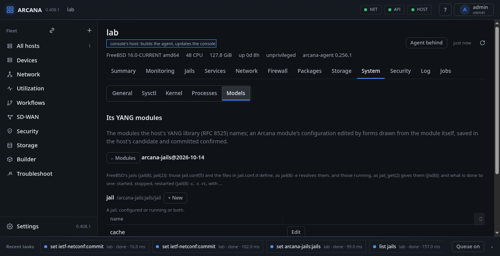

# System and host security

Two tabs of a host, **System** and **Security**, and what the Storage,
Log, Sysctl and IPsec tabs show beside their own: the system's own
configuration, FreeBSD's files and daemons. A file is written whole
by a task (`sysfile`), one of a fixed table and no other path, and the
daemon that reads it is told; the rest is changed by the task that owns
it (`ntp`, `kmod`, `sysctl`, `service-action`, `service-config`,
`geom`). `arcanactl system` reads it all; `arcanactl sysfile FILE PATH`
writes a file.

## System

- **Configuration files**: whether a commit writes `rc.conf(5)` and
  `loader.conf(5)` into Arcana's own files or the system's, and
  **Switch**: see [Configuration files](config-files.md).
- **Time (NTP)**: the servers `ntpd(8)` keeps time by (`ntp.conf`,
  eight at most; ntpd enabled and restarted), and its peers
  (`ntpq -pn`).
- **Linux compatibility**: `linux(4)`, `linux_enable` and its modules
  (linux, linux64, linprocfs, linsysfs, fdescfs). The Linux userland is
  a package or a jail of its own; Arcana installs none.
- **Service jails**: `rc(8)` runs a service in a jail of its own
  (`NAME_svcj`, FreeBSD 15), with the options that give it the network
  (`net_basic`, `net_all`), NFS, routing, SysV IPC and the others.
- **periodic(8)**: each script of the daily, weekly, monthly and
  security runs on or off, its default beside (`periodic.conf`, by
  `sysrc -f`), and `periodic.conf` itself.
- **devd(8)**: rules of its own beside the system's
  (`/usr/local/etc/devd/arcana.conf`), devd restarted.
- **Resource limits (rctl)**: `rctl(8)`'s rules, a jail's, a user's, a
  login class's or a process's, by a form or `rctl.conf` itself; what
  is limited now below it. rctl needs `kern.racct.enable=1`, a tunable
  of the boot: where it is off, a button writes it to
  `/boot/loader.conf.d/arcana.conf` for the next boot.

## Models

**System**, **Models** is the host's YANG modules, as its YANG library
(RFC 8525) names them, each with its revision. A module of Arcana's
picked shows its configuration: each list as a table of its entries,
each entry edited by its form, with **New**; each container with
**Edit**. The forms are not written by hand: the page draws them from
the module itself.

- A field follows its node's type: a boolean or an `empty` is a
  checkbox, an enumeration or an identityref a choice of its values
  (the identities of modules the host has), an integer a number input
  within its range; anything else is text, its pattern, length, range,
  units and default said beside. A leaf-list is a value a line, a
  container a fieldset, a list inside it entries added and taken away,
  a choice its cases to pick.
- The keys come first, fixed in an entry that is there; what is
  mandatory is marked; each node's description is the help under its
  field. What is not configuration, and what the host's library does
  not have, is left out.
- An entry that is there is read from the host's running datastore
  and filled in. The page checks the obvious first (mandatory, range,
  length, pattern, an enum's name); the rest is the host's, and an
  error the host gives is said at its field.
- **Save** writes it into the host's candidate (a new entry POSTed into
  its parent, one there or a container PUT) and commits it confirmed,
  then confirms it: the host undoes it by itself if the console is not
  heard from again, as with every commit ([The API:
  RESTCONF](../automation/restconf.md)).

The Jails tab's **New jail (from its model)** is the same form, of
`arcana-jails`' `jail`: its name, whether it starts at boot, its
parameters. A module is described for the forms at
`/yang/<module>@<revision>.json`, which an API client and the Android
app can read too: see [The API: RESTCONF](../automation/restconf.md#forms-a-module-described).

## Security

- **Audit**: `auditd(8)` on or off; `audit_control` (what is recorded
  of everyone) and `audit_user` (of a user, more or less). The records
  are BSM, in `/var/audit`, read by `praudit(1)`.
- **Kerberos**: `krb5.conf`, the realms and their KDCs.
- **MAC policies**: `mac(4)`'s modules, each loaded or unloaded and
  kept in `kld_list` for the next boot: `mac_bsdextended` (`ugidfw`),
  `mac_portacl`, `mac_seeotheruids`, `mac_partition`, `mac_ifoff`,
  `mac_ntpd`, `mac_do` (`mdo(1)`). MLS, Biba and LOMAC are loaded at
  boot alone, from `loader.conf`.
- **securelevel**: now, and at boot (`kern_securelevel_enable`,
  `kern_securelevel`); raised now too where asked, never lowered while
  the host runs (`security(7)`).

## Beside the other tabs

- **Storage: GEOM**: each class loaded and its providers (`geom CLASS
  status`), the tree (`geom -t`), and a class's command by a form:
  mirror, stripe, concat, raid3, label, nop, multipath, shsec, virstor,
  cache, journal, eli or union, its subcommand one of the class's own
  (`gmirror label`, `gstripe create`, `geli init`...). **GELI**: its
  providers (`geli list`), and the same form, a passphrase given to geli
  by a file of the task's own on the host, never on a command line.
  **devfs**: `devfs.rules`, what each rule set shows of `/dev` (a
  jail's by its `devfs_ruleset`).
- **Log: Configuration**: `syslog.conf` and `newsyslog.conf`, and a
  line that sends the logs to another host (`*.* @host`).
- **Sysctl: Hardening**: the sysctls `security(7)` and hardening guides
  set (users seeing their own processes, no hard links to others'
  files, ASLR, no W^X memory, blackholes for closed ports, no ICMP
  redirects or source routing...), as this kernel has them: now, what
  hardened is, why; each applied, or all that differ, kept in
  `sysctl.conf`.
- **IPsec: setkey**: `ipsec.conf`, `setkey(8)`'s policies and manual
  keys (root's alone), the policies now (`setkey -DP`); IKE
  (strongSwan) makes them for those it knows.
