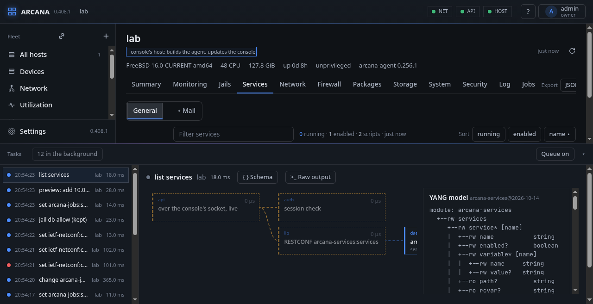

# Services

**Services** lists every `rc.d` script of the host, or of a jail picked
above the list, with whether it runs and whether it is enabled.

Each service has the buttons that make sense for it: **Start** or
**Stop**, **Restart**, and **Enable** or **Disable**, which changes
`rc.conf`. A service's drawer holds its `rc.conf` variables, changed in
safe mode and taken back if the change cut the host off.

A jail picked runs its own services: the script by the jail's
`service(8)` (`service -j`), the variables in the jail's `rc.conf`
(`sysrc -j`). A service whose program runs while `rc(8)` thinks it
stopped has a stale pidfile, and **Mend pidfile** in place of
**Start**; see [Services](../sections/host.md#services).

Services sort by whether they run, whether they are enabled, or by
name, and filter as you type.

**FreeBSD:** the list is the scripts in `/etc/rc.d` and
`/usr/local/etc/rc.d`, asked with `service(8)` for their status; a
variable is read and set with `sysrc(8)`; for a jail, the jail's own
`service -j` and `sysrc -j`, through `jexec(8)`.

